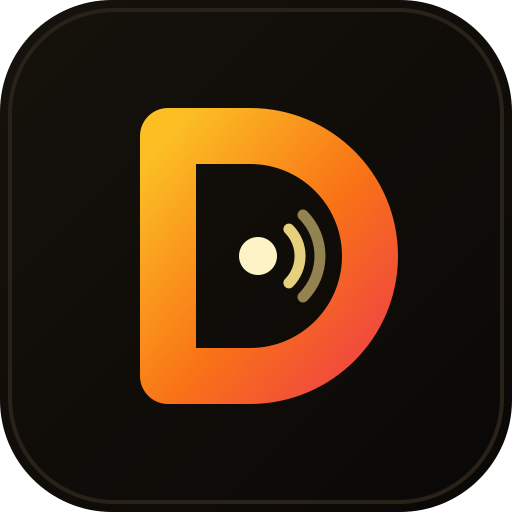

# DarmawanRobotics/.github

**The organization profile of [Darmawan Robotics](https://github.com/DarmawanRobotics): the [profile README](profile/README.md), the
logo and banner, and the metrics rendered from the organization's repositories.**

| Path | |
|---|---|
| `profile/README.md` | shown on [github.com/DarmawanRobotics](https://github.com/DarmawanRobotics) |
| `assets/logo.svg`, `assets/avatar.png`, `assets/banner.png` | logo, the organization's profile picture (512 × 512), profile banner |
| `metrics/*.svg` | commits, overview with issues and pull requests, languages, lines of code |
| `.github/workflows/metrics.yml` | renders the metrics with [lowlighter/metrics](https://github.com/lowlighter/metrics) every 12 hours, on demand, and when the workflow changes |

The workflow needs a `METRICS_TOKEN` repository secret: a classic personal access token with the `repo`,
`read:org` and `read:user` scopes, so private repositories count towards the languages without being named.
Run it by hand with `gh workflow run metrics -R DarmawanRobotics/.github`.
